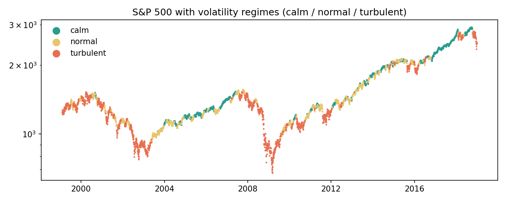
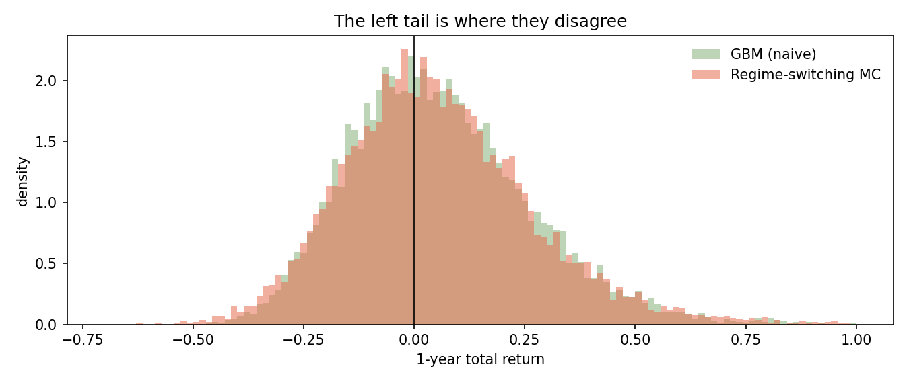
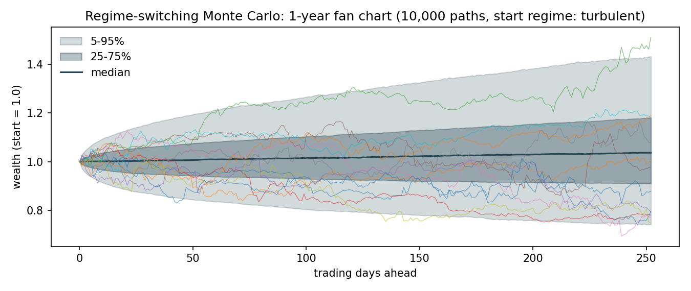

# Regime-Switching Monte Carlo

**Why does the textbook market simulation understate crash risk — and what does
it take to fix it?** This project answers with a Markov-chain regime model,
compared head-to-head against geometric Brownian motion on 20 years of real
S&P 500 data.

## The idea

Markets don't have one personality. They alternate between long quiet stretches
and violent clusters of volatility. This project models that with three pieces:

1. **Regimes** — every day is classified *calm / normal / turbulent* by trailing
   21-day realised volatility terciles. Rule-based and auditable by hand — no
   latent-state black box.
2. **A Markov chain** — the probability of tomorrow's regime given today's,
   estimated by simple counting. On S&P 500 data (1999–2018):

   |            | → calm | → normal | → turbulent |
   |------------|-------:|---------:|------------:|
   | **calm**      | 0.956 | 0.044 | **0.000** |
   | **normal**    | 0.044 | 0.924 | 0.032 |
   | **turbulent** | 0.000 | 0.032 | 0.968 |

   Regimes are strongly persistent (diagonal ≈ 0.92–0.97) — that persistence
   *is* volatility clustering. And note the zeros: the market never jumps
   straight between calm and turbulent; it always transitions through normal.
3. **Monte Carlo** — 10,000 alternate futures. Each path walks the Markov chain
   day by day and draws that day's return from the **empirical pool of its
   regime** (bootstrap, no normality assumption anywhere).



## The payoff: naive simulation hides the tail

Same data, same horizon, two simulators (`results/risk_comparison.csv`):

| 1-year ahead | GBM (naive) | Regime-switching MC |
|---|---:|---:|
| mean return | +5.8% | +5.6% |
| VaR 5% | 23.9% | 25.8% |
| **CVaR 1%** | **36.9%** | **42.9%** |
| worst simulated drawdown | −50% | **−66%** |

Both simulators agree on the average year. They disagree exactly where it
matters — the left tail. The reason is visible in the stylized facts
(`results/stylized_facts.csv`):

| | excess kurtosis | vol-clustering (acf of \|r\|) |
|---|---:|---:|
| **real S&P 500** | **8.35** | **0.24** |
| GBM (naive) | 0.01 | 0.00 |
| Regime-switching MC | 5.94 | 0.13 |

GBM is thin-tailed and memoryless by construction, so it cannot produce the
crash clustering that generates deep drawdowns. The regime model recovers most
of both facts with just a 3×3 transition matrix and empirical sampling.





## Honest limitations

- Regime classification uses full-sample vol terciles (fine for describing
  history and risk simulation; a live system would estimate terciles on a
  rolling window).
- First-order Markov chain: tomorrow's regime depends only on today's. Real
  markets may carry longer memory.
- This is a **risk tool, not a return forecaster** — it makes no claim of
  predicting direction, only of simulating realistic distributions.

## Reproduce everything

```bash
pip install -r requirements.txt
python run_simulation.py   # tables -> results/
python plots.py            # figures -> figures/
pytest -q                  # invariants + the fat-tails claim as a test
```

Data: S&P 500 daily closes bundled in the `arch` package — no API keys needed.

## Layout

- `src/regimes.py` — regime classification, transition matrix, stationary distribution
- `src/simulate.py` — GBM benchmark and the regime-switching MC engine
- `src/risk.py` — VaR/CVaR, drawdown distributions, stylized-facts validation
- `run_simulation.py`, `plots.py` — the demo; `tests/` — 6 invariant tests
